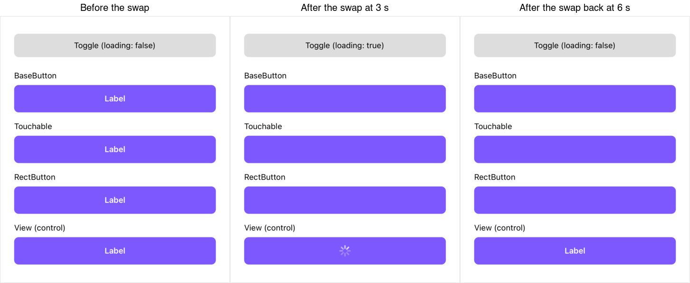

# rngh-button-child-order-repro


Reproducer for a `react-native-gesture-handler` iOS bug: content mounted into a button **after its
first render** ends up *behind* its siblings, so the button looks blank.

- react-native `0.88.0` (this template's version, New Architecture), react-native-gesture-handler `3.3.0`
- iOS only. Android is not affected. 2.33.x is not affected.
- Issue: _link to be added_

## Steps

1. `cd ReproducerApp && yarn && cd ios && bundle install && bundle exec pod install && cd ..`
2. `yarn ios`
3. Wait about 6 s, or tap **Toggle**.

The only changes from the template are `ReproducerApp/App.tsx` and adding
`react-native-gesture-handler@3.3.0`.

## Expected

Each RNGH button (BaseButton, Touchable, RectButton) shows the same content as the `View` control:
a spinner from 3 s, the label again from 6 s.

## Actual

From the first swap on, the RNGH buttons show only the purple background. The `View` control
updates normally.



## Why

Each button's content sits inside a View that only has a background. Fabric flattens that View and
mounts its children into the button itself, right after it. On iOS the button keeps an underlay
`CALayer` at sublayer index 0, and `-[UIView insertSubview:atIndex:]` counts every sublayer, so a
child mounted after the first layout lands one position too low: below the background View.

# How to use this Reproducer

This project has been created with `npx @react-native-community/cli init` and is a vanilla React Native app.

> [!IMPORTANT]  
> Make sure you have completed the [React Native - Environment Setup](https://reactnative.dev/docs/set-up-your-environment) so that you have a working environment locally.

## Step 1: Start the Metro Server

First, you will need to start **Metro**, the JavaScript _bundler_ that ships _with_ React Native.

To start Metro, run the following command from the _root_ of your React Native project:

```bash
# using npm
npm start

# OR using Yarn
yarn start
```

## Step 2: Start your Application

Let Metro Bundler run in its _own_ terminal. Open a _new_ terminal from the _root_ of your React Native project. Run the following command to start your _Android_ or _iOS_ app:

### For Android

```bash
# using npm
npm run android

# OR using Yarn
yarn android
```

### For iOS

First, make sure you install dependencies with:

```bash
cd ios && bundle install && bundle exec pod install
```

Then you can run the iOS app with:

```bash
# using npm
npm run ios

# OR using Yarn
yarn ios
```

If everything is set up _correctly_, you should see your new app running in your _Android Emulator_ or _iOS Simulator_ shortly provided you have set up your emulator/simulator correctly.

This is one way to run your app — you can also run it directly from within Android Studio and Xcode respectively.

## Step 3: Modifying your App

Now that you have successfully run the app, let's modify it.

1. Open `App.tsx` in your text editor of choice and edit some lines.
2. For **Android**: Press the <kbd>R</kbd> key twice or select **"Reload"** from the **Developer Menu** (<kbd>Ctrl</kbd> + <kbd>M</kbd> (on Window and Linux) or <kbd>Cmd ⌘</kbd> + <kbd>M</kbd> (on macOS)) to see your changes!

   For **iOS**: Hit <kbd>Cmd ⌘</kbd> + <kbd>R</kbd> in your iOS Simulator to reload the app and see your changes!
